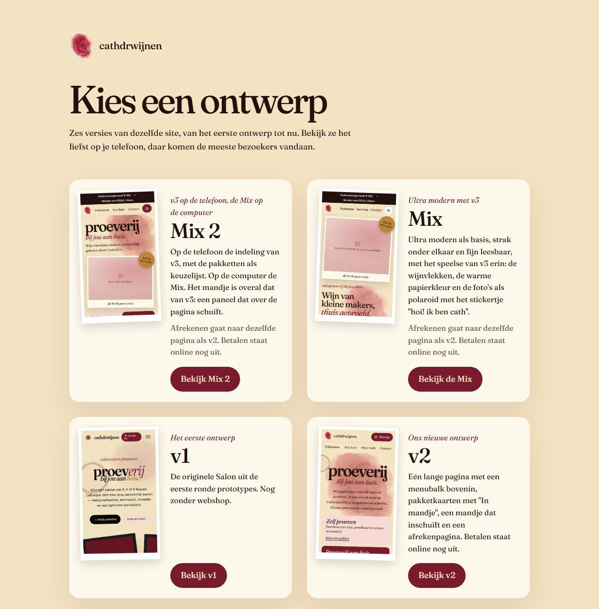
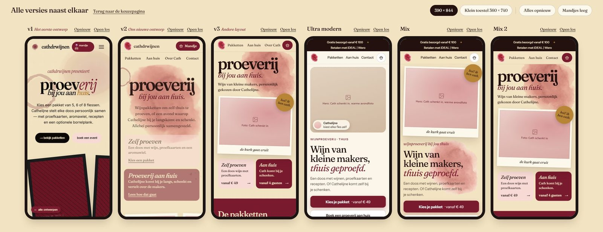

<div align="center">

# cathdrwijnen

**Website and webshop concepts for Cath d'r Wijnen**: DIY wine-tasting boxes and tastings at your home. One hub lets you compare every version side by side.

[](https://erbendriessen.github.io/Cathdrwijnen/hub.html)


[](https://github.com/ErbenDriessen/Cathdrwijnen/actions/workflows/links.yml)
[](https://erbendriessen.github.io/Cathdrwijnen/hub.html)

</div>

## 🍷 The versions

All versions are reachable from the [hub](https://erbendriessen.github.io/Cathdrwijnen/hub.html). Each link opens with the 18+ question reset, so you see the site the way a new visitor does.

| Version | What it is |
| --- | --- |
| [**Mix 2**](https://erbendriessen.github.io/Cathdrwijnen/Cathdrwijnen-mix2.dc.html?leeftijd-opnieuw) | The v3 layout on phones, the Mix on computers. The cart slides over the page. |
| [**Mix**](https://erbendriessen.github.io/Cathdrwijnen/Cathdrwijnen-mix.dc.html?leeftijd-opnieuw) | Ultra modern as the base, with the wine stains, paper colour and polaroids of v3. |
| [**Ultra modern**](https://erbendriessen.github.io/Cathdrwijnen/Cathdrwijnen-v4.dc.html?leeftijd-opnieuw) | Clean and calm: package cards with a price per bottle and a two-step tasting request. |
| [**v3**](https://erbendriessen.github.io/Cathdrwijnen/Cathdrwijnen.dc.html?leeftijd-opnieuw) | Packages as one choice list with a single button and a bottom-sheet cart. |
| [**v2**](https://erbendriessen.github.io/Cathdrwijnen/salon-v2.html?leeftijd-opnieuw) | The original Salon worked out into a full webshop with cart and checkout. |
| [**v1**](https://erbendriessen.github.io/Cathdrwijnen/salon.html) | The first Salon concept, no webshop yet. |

[**All versions side by side on phone size**](https://erbendriessen.github.io/Cathdrwijnen/naast-elkaar.html), since most visitors come from their phone:

[](https://erbendriessen.github.io/Cathdrwijnen/naast-elkaar.html)

The very first concepts (Salon, Carafe, Journal) are still in the [old gallery](https://erbendriessen.github.io/Cathdrwijnen/).

## ✨ Features

- **Webshop with checkout**: packages go into a cart, the checkout page collects delivery details, and payment runs through Mollie (iDEAL | Wero, cards).
- **One source for prices**: `pakketten.json` holds the packages, prices and delivery costs. The site and the payment server both read it, so a price is changed in one place.
- **18+ age check**: a required pop-up before buying (Alcoholwet), the official NIX18 logo, and an 18+ confirmation on every order.
- **Legal basics for a Dutch webshop**: a withdrawal page ("Hier je bestelling ontbinden"), terms and privacy pages, and company details in every confirmation mail.
- **Tasting request and contact forms**: sent through Formspree, with validation and clear error messages.
- **Mobile first**: every version is built for phones first, with a visible menu bar instead of a hamburger.
- **Test mode**: with the example config (no Mollie key, mails written to files) the backend shows a fake payment page, so the whole order flow can be tried locally.

> On GitHub Pages there is no PHP, so the checkout shows a demo notice and nothing can be paid.

## 🛠 Tech stack

- **HTML5, CSS3 and vanilla JavaScript** for v1, v2 and the shop pages
- **Component prototypes** for v3, Ultra modern, Mix and Mix 2: `.dc.html` files rendered by a small runtime (`support.js`, React from unpkg)
- **PHP 8.2+** without a database or Composer: orders are stored as JSON files, and Mollie is called with plain cURL
- **Formspree** for the forms
- **GitHub Pages** for the demo, with a link-checking CI workflow

## 📁 Project structure

```text
Cathdrwijnen/
├── hub.html                    # choose a version
├── naast-elkaar.html           # all versions as phones side by side
├── Cathdrwijnen-mix2.dc.html   # Mix 2
├── Cathdrwijnen-mix.dc.html    # Mix
├── Cathdrwijnen-v4.dc.html     # Ultra modern
├── Cathdrwijnen.dc.html        # v3
├── salon-v2.html               # v2
├── salon.html                  # v1
├── afrekenen.html              # checkout
├── bedankt.html                # order confirmation
├── ontbinden.html              # withdrawal form
├── voorwaarden.html            # terms (placeholder)
├── privacy.html                # privacy statement (placeholder)
├── pakketten.json              # packages, prices and delivery costs
├── api/                        # PHP backend (Mollie, mails, orders), see api/LEESMIJ.md
├── js/  css/                   # cart, age check, checkout, styles
├── support.js  image-slot.js   # runtime for the .dc.html prototypes
├── index.html                  # gallery of the first concepts
└── assets/                     # logo, NIX18, previews
```

## 🚀 Getting started

No build. Clone the repo and serve the folder.

```bash
git clone https://github.com/ErbenDriessen/Cathdrwijnen.git
cd Cathdrwijnen

# Just the designs: any static server works
python -m http.server 8000
# then visit http://localhost:8000/hub.html

# The full order flow, including the test payment page: use PHP
php -S localhost:8000
```

To set up the backend for real (Mollie key, mail, company details), copy `api/config.voorbeeld.php` to `api/config.php` and follow [`api/LEESMIJ.md`](./api/LEESMIJ.md). `api/config.php` and the orders in `data/` stay out of git.

## 📄 License

Personal / client concept project. © 2026 Erben Driessen. All rights reserved.
